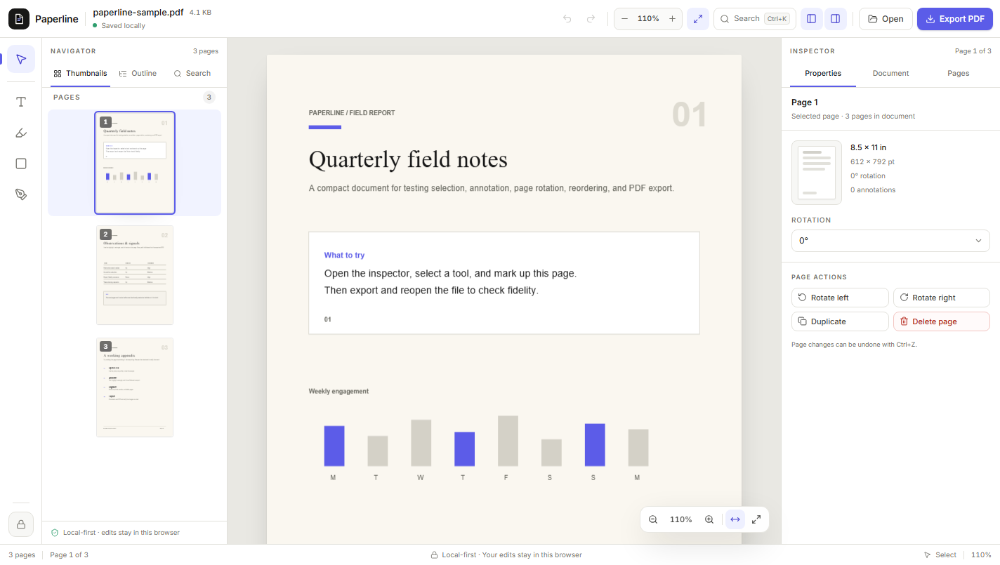

# Paperline

Paperline is a local-first PDF editor that runs entirely in the browser. Open a PDF, add text and markup, rotate or reorganize pages, and export a real PDF with those changes baked in. Files are processed on the device; there is no upload or account requirement.



This repository is the first production-quality milestone of a larger PDF editing product. It focuses on a reliable core: high-fidelity rendering, real PDF mutation on export, page organization, annotation, session recovery, and a premium editing shell. The gaps are documented honestly in [FEATURE_MATRIX.md](./FEATURE_MATRIX.md) and [KNOWN_LIMITATIONS.md](./KNOWN_LIMITATIONS.md).

## What works

- Open a local PDF with the file picker, drag-and-drop, or the bundled sample.
- Render pages with PDF.js, including zoom, fit width/page, rotation, thumbnails, and continuous scrolling.
- Navigate with the outline, full-document search, page thumbnails, and keyboard shortcuts.
- Add text boxes, highlights, rectangles, and freehand ink annotations.
- Select, move, restyle, and delete annotations.
- Rotate, duplicate, reorder, and delete pages.
- Undo and redo editing and page operations.
- Autosave editable state to browser local storage and recover it when the same file is reopened.
- Export a valid PDF with annotations flattened and page changes applied.
- Edit document metadata (title, author, subject, keywords) before export.
- Use a command palette and keyboard-first workflow.

## Quick start

```bash
npm install
npm run dev
```

Open the URL printed by Vite. Click **Try sample** to load `public/sample.pdf`, or open your own PDF.

### Scripts

| Command | Purpose |
| --- | --- |
| `npm run dev` | Start the Vite dev server. |
| `npm run build` | Type-check and build for production. |
| `npm run preview` | Preview the production build. |
| `npm run lint` | Run oxlint. |
| `npm test` | Run the Vitest regression suite. |
| `npm run sample` | Regenerate `public/sample.pdf`. |
| `npm run verify:pdf -- <path>` | Inspect page count, rotations, metadata, and extracted text from an exported PDF. |

## Architecture

```
src/
  components/
    editor/        PDF workspace, page canvas, annotation layer, thumbnails,
                   outline, search, inline text editor
    shell/         Top bar, tool rail, navigator, inspector, status bar
    ui/            Small design-system primitives
  lib/
    pdfjs.ts       PDF.js worker configuration and loader
    exportPdf.ts   pdf-lib export pipeline
    geometry.ts    PDF/user-space ↔ viewport coordinate helpers
    search.ts      Full-document text search
    download.ts    Browser download helper
  store/
    editorStore.ts Zustand document/edit state, history, autosave, export
  types/
    editor.ts      Shared document, page, and annotation contracts
tests/             Export fidelity regression tests
scripts/           Sample generation and PDF verification utilities
```

### Why Vite instead of Next.js

Paperline is a client-side document editor. There is no server rendering or backend requirement, and PDF.js/pdf-lib are browser libraries. Vite keeps the document runtime small and explicit. A Next.js server layer can be added later for cloud libraries, collaboration, or signing without changing the editor's core.

### Coordinate model

Annotations are stored in PDF user space: 72 points per inch, origin at the bottom-left of the unrotated page. PDF.js viewport transforms are used for pointer input and overlay rendering, so zoom and page rotation stay aligned. On export, the same stored coordinates are passed directly to pdf-lib.

### Export pipeline

1. Load the original PDF bytes with pdf-lib.
2. If the page order is unchanged, mutate the original document in place to preserve as much structure as possible.
3. If pages were reordered, duplicated, or deleted, copy pages one at a time into a new document. Copying one at a time avoids a pdf-lib issue where repeated source indices share page objects.
4. Apply page rotations.
5. Draw annotations into the page content as text, rectangles, or line segments.
6. Update metadata and save a fresh PDF.
7. Download the result through a Blob URL.

Annotations are flattened on export. Untouched text, vector content, images, and fonts remain real PDF content rather than screenshots.

## Local-first behavior

- The PDF binary is read locally and passed to PDF.js.
- Editable page and annotation state is saved to `localStorage` under a key derived from file name, size, and modification time.
- When the same file is reopened, Paperline offers to restore the saved edits.
- No telemetry, accounts, or uploads are part of this build.

## Testing

```bash
npm test
```

The export suite covers:

- Metadata and page-rotation preservation.
- Annotation flattening and text extraction.
- Independent content for duplicated pages.
- Page reordering and deletion.

See [QA_REPORT.md](./QA_REPORT.md) for the browser smoke-test evidence.

## Accessibility

The shell includes labelled controls, keyboard navigation, visible focus rings, modal focus management, and reduced-motion support. The production Lighthouse accessibility score is 100.

## Status

This is a strong local-editor milestone, not a claim of full Adobe Acrobat parity. Existing-PDF text editing, AcroForm editing, OCR, true redaction, image insertion, digital signatures, and cloud collaboration are intentionally left for later phases rather than shipped as fake controls. See [FEATURE_MATRIX.md](./FEATURE_MATRIX.md) for the complete status.
